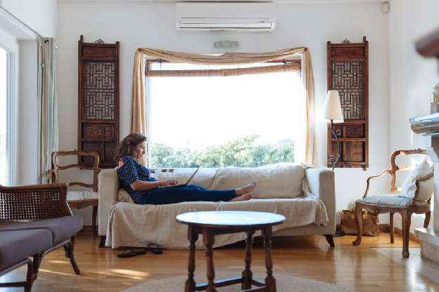
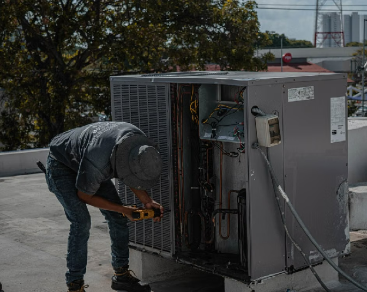

**Meta Description:** Is your Texas apartment AC a quick filter fix or a job for a pro? Learn which cooling problems renters can check, which need an HVAC technician, and how to report them.

# How to Tell Whether an Apartment Cooling Problem Needs Maintenance or Professional Repair

[Source](https://www.pexels.com/photo/woman-sitting-on-sofa-in-living-room-1595589/)

The AC keeps running, but the apartment still feels warm. The thermostat says one temperature while the living room seems stuck at another, and you can't tell whether anything is actually broken.

In Texas, that question comes up fast. Houston and the Gulf Coast pair 95°F afternoons with heavy humidity. Dallas–Fort Worth, Austin and San Antonio regularly go past 100°F for days at a time. When your apartment's air conditioner falls behind in July or August, you need to know whether the fix is a two-minute filter swap or a service call.

As a renter, you can usually reach the filter and the thermostat, but you probably know little about the equipment behind a locked closet panel, on the roof, or in a row of condensers behind the building. That makes cooling complaints hard to describe. "It isn't cooling" tells maintenance you're uncomfortable, but it doesn't separate a simple upkeep issue from a fault inside the equipment. The useful starting point is what the system is doing, not how long it has been running.

This guide covers the checks Texas renters can safely do themselves, the warning signs that call for a licensed HVAC technician, your basic repair rights under Texas law, and how to write a maintenance request that actually gets action.

## The Quick Answer and a Simple Vent Temperature Test

Problems with airflow and settings you can reach yourself are maintenance problems. Faults inside the refrigerant or electrical parts belong with a professional, even when the symptoms look the same.

A basic vent test gives you a starting point. Let the cooling run steadily for at least 15 minutes. Then use an inexpensive digital or probe thermometer to measure the air going into the return grille (the large vent, usually with the filter behind it). Next, measure the air coming out of a supply vent close to the indoor unit.

As rough screening guidelines, a temperature difference of about 17–20°F between those two readings suggests cooling is happening. A difference below 15°F after basic checks is worth reporting, and one above 22°F can suggest restricted airflow.

| Return-to-supply temperature difference | What it may suggest | Your next step |
| --- | --- | --- |
| Under 15°F | Weak cooling. Possible airflow restriction, refrigerant problem or failing part. | Check the filter, vents and thermostat, then report if nothing changes. |
| About 17–20°F | The system is removing heat normally. | Look at airflow, sun exposure and how long the system runs before assuming a fault. |
| Over 22°F | Air may be moving too slowly across the coil. | Check for a clogged filter or blocked returns, and watch for ice. |
| No cool air at all | Possible electrical, control or compressor problem. | Check the thermostat and breaker once, then report right away. |

These aren't pass-or-fail thresholds. Humidity, equipment design and where you take the measurement all affect the readings, and Texas humidity in particular can shrink the difference on muggy days. A normal-looking split also doesn't prove your apartment is getting enough cooling. A unit can cool the air properly and still lose ground in a west-facing apartment on a 104°F afternoon.

## Why Texas Heat Changes the Picture

Most residential air conditioners are sized to hold the indoors about 20°F below the outdoor temperature on a typical hot day. When it's 103°F outside, an indoor reading of 80–82°F in the late afternoon may mean the system is at the limit of its design, not that it's broken.

That matters when you decide what to report. Look for these patterns before you assume a breakdown:

- **Temperatures recover overnight.** If the apartment cools to your setpoint after sunset, the system is probably working but struggling with peak heat.
- **The unit runs nonstop during the day.** Long run times are normal in a Texas summer. Running nonstop with warm air coming out of the vents is not.
- **Only some rooms are hot.** Bedrooms with large west-facing windows, top-floor units under a hot roof and rooms far from the air handler often run warmer.
- **The apartment feels clammy.** In Houston, Corpus Christi and Beaumont, AC removes moisture as well as heat. Sticky air at a reasonable temperature can point to a drainage, sizing or airflow problem worth mentioning.

On the other hand, an apartment that keeps getting warmer through the evening, warm air from the vents, or a system that won't turn on at all points to a real fault, not just a hot day.

## What Renters Can Safely Handle on Their Own

With the vent test as a starting point, you can check the filter, vents and settings before leaving equipment-level problems to maintenance.

### Filters, Vents and Thermostat Settings

A dirty air filter is the first thing to check when airflow weakens. In Texas, where cooling can run eight or nine months a year, check it monthly in summer, and replace or clean it following the equipment instructions. Many apartment leases make the filter the resident's job, while some properties swap filters on a schedule. Check your lease or resident portal. Use the filter size and MERV rating the system calls for: a higher rating isn't automatically better, because a very dense filter can choke airflow on some systems.

Keep furniture, rugs and curtains off vents and registers, and make sure supply louvers aren't closed by accident. Return grilles need open space too. A couch pushed against the return can starve the whole system. These checks are part of the property's broader [preventive maintenance for cooling systems](https://riseapartments.com/preventative-maintenance-is-the-foundation-of-successful-apartment-communities/), and you can handle your share of them in a few minutes.

The thermostat should show cooling mode and a setpoint below the room temperature. With the fan on "Auto," it runs only when the system is cooling. With it on "On," it keeps moving air between cycles, which can raise indoor humidity in a humid climate.

Replace the thermostat batteries if it uses them. A blank or flickering screen is often just dead batteries. None of these adjustments means frozen coils or persistent weak cooling have been fixed.

### Breakers, Drain Lines and Unit-Specific Care

You can reset a tripped circuit breaker once. If it trips again, stop there and report it, because a repeat trip points to an electrical or equipment fault that needs a professional.

Standing water near the indoor unit can mean a blocked condensate drain line. Texas humidity makes this common: a working AC in Houston can pull gallons of water out of the air on a summer day, and algae in the drain line can back it up. Your part ends at a visible clog you can reach, and only if the property's instructions say you can clear it. Some communities ask residents to pour a cup of diluted vinegar into an accessible drain port as routine care, and others want maintenance to handle any drain work.

Residents who [learn more](https://robsair.com/) about technician-level diagnostics, like flushing a drain inside the air handler or tracing repeated breaker trips, gain useful context before discussing the problem with maintenance. That knowledge doesn't make the repair your responsibility, but it helps you describe what you're seeing.

Window and portable units have model-specific filter and drain routines. With central and split systems, the condenser coil and outdoor equipment are generally the property's job. Water coming back, or leaking toward a neighbor's apartment below, should also go to maintenance staff right away.

| Check | Renter can do it? | Where to stop |
| --- | --- | --- |
| Inspect and replace the air filter | Yes, if the lease puts it on you | The filter is fine but airflow is still weak |
| Open vents and clear returns | Yes | Every vent is open and some rooms are still hot |
| Thermostat mode, setpoint and batteries | Yes | Settings are right but the system doesn't respond |
| Reset a tripped breaker | Once | The breaker trips again |
| Clear a visible drain clog | Only if property instructions allow | Water keeps returning or the clog is inside the unit |
| Refrigerant, wiring, motors, outdoor condenser | No | Always report these |

## Signs the Problem Belongs to an HVAC Technician

[Source](https://www.pexels.com/photo/man-drilling-an-aircon-casing-5463581/)

When basic checks don't bring the cooling back, your job shifts from adjusting things to documenting them. A low vent split supports that handoff, but it doesn't identify the failed part.

### Refrigerant Leaks and Coils That Keep Freezing

Hissing, ice on the refrigerant lines and coils that keep freezing are reasons to report a possible refrigerant leak, not proof of one. Airflow problems can also cause icing, so the technician needs to sort out which it is.

Refrigerant work belongs with an HVAC technician who holds the right EPA Section 608 certification. In Texas, air conditioning contractors are also licensed by the Texas Department of Licensing and Regulation (TDLR). A renter shouldn't attempt a refill.

Pay special attention to ice that comes back soon after thawing when the filter is already clean. Describe that sequence in your report instead of calling it "low refrigerant." If you see ice, switch the system to "Off" (leave the fan on "On" if you like) so the coil can thaw while you wait for service. Running a frozen system can damage the compressor.

A technician can check refrigerant levels, blower operation and blockages you can't reach from inside the apartment. Inspecting the outdoor condenser coil is also the professional's job, especially in Texas, where cottonwood fluff, grass clippings and dust can coat the outdoor coil and cut its capacity.

### Short Cycling, Odd Noises and Burning Smells

Short cycling means the system keeps starting and stopping without completing a cooling run. The cause could be the controls, the wrong-size equipment or an electrical fault, and changing thermostat settings over and over won't tell them apart.

When you report buzzing or grinding, say where the sound comes from and when it happens. That helps separate a normal startup noise from a problem that continues the whole time the system runs, without you having to diagnose a motor or capacitor failure. Capacitors fail often in extreme heat, and a humming outdoor unit with a fan that won't spin is a classic symptom worth describing.

If you smell burning or something electrical, turn the cooling off at the thermostat and report it immediately. If you see smoke or fire, get out and call 911.

A musty smell calls for a different report. Describe any water or dampness you've noticed rather than assuming the smell points to a specific fault.

### Water Damage and Mold Concerns

Texas humidity makes AC-related water problems more than an inconvenience. Water stains on the ceiling under the air handler closet, a soggy carpet near the unit or spotting on the walls should all be reported promptly and in writing. Ongoing moisture can lead to mold, which is a health concern and gets more expensive to fix the longer it's left. Take photos the day you notice the problem.

## Symptom-by-Symptom Triage Guide

Use this table to decide what to do next. It isn't a diagnosis, but it helps you choose between a quick check and a work order.

| Symptom | Likely category | What to do | Urgency |
| --- | --- | --- | --- |
| Weak airflow from every vent | Maintenance (filter) first | Replace the filter, open the returns, retest | Routine if it improves |
| Air blowing but not cold | Professional | Check the thermostat mode, then submit a request with vent readings | High in summer |
| Ice on lines or the indoor coil | Professional | Turn cooling off, let it thaw, report with photos | High |
| Water around the indoor unit | Maintenance or professional | Clear only a visible, permitted clog, otherwise report | High if it's spreading |
| Breaker trips twice | Professional | Leave it off and report | High |
| System won't turn on | Maintenance first | Check batteries, settings and the breaker once, then report | High in summer |
| Burning or electrical smell | Professional, possible emergency | Turn the system off and report immediately; call 911 if there's smoke | Emergency |
| Short cycling | Professional | Note how often it cycles and report | Moderate to high |
| One room much warmer than the rest | Maintenance first | Check vents and doors, then report the pattern | Routine |
| Musty smell | Professional or property | Report any dampness or visible growth | Moderate |

## Your Repair Rights as a Texas Renter

Knowing what Texas law says helps you make a request that's hard to ignore. Texas has no statewide law that specifically requires landlords to provide air conditioning. But the Texas Property Code (Section 92.052) requires landlords to make a diligent effort to repair conditions that materially affect the physical health or safety of an ordinary tenant. In serious Texas heat, a failed AC can meet that standard, especially for older residents, young children or people with medical conditions.

Under Section 92.056, a landlord's liability for failing to repair generally depends on all of these conditions:

- You gave notice to the person or place where you normally pay rent.
- The condition materially affects the physical health or safety of an ordinary tenant.
- You gave a second written notice after a reasonable time, unless your first notice went by certified mail or another trackable method.
- The landlord had a reasonable time to fix the problem and didn't make a diligent effort.
- You weren't behind on rent when you gave notice.

The law presumes that seven days is a reasonable time to make the repair, but that presumption can be challenged depending on how severe the problem is and whether parts and labor are available. During a heat wave, parts and technicians can be scarce, which is one more reason to report early and keep good records.

Some cities go further. Dallas's housing code has long required cooling equipment that keeps habitable rooms 15°F cooler than outside and no warmer than 85°F. In August 2026, the Houston City Council approved an ordinance requiring operable air conditioning in rental units, which can include window or portable units in older buildings. Austin and other cities have debated their own standards. Rules and effective dates change, so check your city's current code and read your lease before you act.

This section is general information, not legal advice. Before you use remedies like repair-and-deduct or ending your lease, talk with a Texas tenant rights organization or an attorney. Those remedies have strict requirements, and getting them wrong can put you at risk of eviction.

## Reporting the Problem and Following Up When It Stalls

The checks you've already done give maintenance a starting point. A written record separates an unresolved equipment problem from a vague comfort complaint.

### Writing a Repair Request That Gets Action

A useful portal request or email names the symptom, when it started, your thermostat settings and any vent readings. It also notes the filter condition, that the vents are open and what adjustments you've already tried.

For example, "Cooling runs nonstop. Return air measured 78°F and supply air 70°F after the filter change" gives maintenance far more to work with than "AC broken." Include how you took the measurements and whether the system had been running steadily.

A strong request includes:

- **Your unit number and the best way to reach you**
- **The symptom**, in plain words (warm air, no air, ice, water, noise or smell)
- **When it started** and whether it's constant or only in the afternoon
- **Readings:** indoor temperature, thermostat setpoint and return and supply vent temperatures
- **What you checked:** filter, vents, thermostat mode, batteries and breaker
- **Photos or video** of ice, water, error codes or the thermostat display
- **Access instructions:** pets, alarm codes and whether you allow entry when you're not home

Clear access instructions help the HVAC technician get to the equipment without another round of scheduling. An acknowledgment and a stated next step are reasonable to expect from [timely apartment maintenance](https://riseapartments.com/fast-maintenance-response-defines-modern-apartment-living/), even when diagnosis and repair take separate visits. Keep a copy of every request, along with the date and time you sent it.

### When Maintenance Still Won't Fix the AC

If a request goes unanswered, send a dated written follow-up that references the original report. Photos of ice, water or error codes on the display add detail. Under Texas law, this follow-up written notice is part of what can make a landlord liable, so don't skip it.

If you still hear nothing, escalate to the property manager or the management company, and point to the maintenance process and timelines in your lease.

If you're waiting on air conditioning repair in Houston, Dallas, Austin or San Antonio during a heat wave, describe the indoor conditions and any heat-related concerns in your follow-up instead of just repeating the original ticket. Mention any household members who are especially vulnerable to heat. Urgent safety concerns shouldn't stay buried in a routine request. Many properties have an after-hours emergency line for exactly this situation.

Approving a repair versus a replacement is up to the landlord or owner. The informal $5,000 rule multiplies the equipment's age in years by the repair estimate, and a result above 5,000 favors replacement. It's a rough budgeting shortcut, though, not a diagnosis or a binding decision. In Texas, where systems work harder and wear out faster than in milder climates, owners of older properties often reach that point sooner.

## Staying Safe While You Wait for Repairs

A broken AC in a Texas summer can become a health problem in hours, not days. While you wait for the repair:

- **Close the blinds and curtains** on sun-facing windows during the day.
- **Run fans to help sweat evaporate**, but don't rely on them alone. Once indoor temperatures climb into the high 90s, fans may not prevent heat illness.
- **Avoid using the oven, stovetop and dryer** during the hottest hours.
- **Drink water regularly** and take cool showers.
- **Check on pets**, older neighbors and anyone with health conditions.
- **Spend the afternoon somewhere cool**, like a library, mall or city cooling center. Texas cities often open cooling centers during heat advisories.
- **Know the warning signs:** dizziness, confusion, nausea, a rapid pulse or no sweating despite the heat. Heat stroke is a medical emergency, so call 911.

If your apartment stays dangerously hot, ask the property in writing whether it can provide a temporary portable unit or other accommodation until the repair is done.

## Choosing an Apartment With Reliable Cooling

The easiest AC problem to solve is the one you avoid by picking the right community. When you tour apartments in Texas, ask these questions before you sign:

- **How old is the HVAC system in this unit, and when was it last serviced?**
- **Who changes the air filters, and how often?**
- **How are maintenance requests submitted, and what's the typical response time for AC issues in summer?**
- **Is there a 24/7 emergency maintenance line, and does it cover AC outages?**
- **Does the property provide temporary portable units during extended repairs?**
- **Which way does the unit face, and is it on the top floor?**

Look at the thermostat model, the condition of the vents and any water stains near the air handler closet during your tour. Reviews that mention slow AC repairs are a red flag. A free apartment locator like Rise Apartments can help you compare Texas communities and ask the right questions about maintenance before you commit to a lease.

## Frequently Asked Questions

**Is a landlord in Texas required to fix the air conditioning?**
Texas law requires landlords to make a diligent effort to repair conditions that materially affect a tenant's health or safety once they get proper notice and the rent is current. A failed AC in extreme heat can qualify, and cities like Dallas and Houston have their own cooling requirements.

**How long does a Texas landlord have to fix a broken AC?**
The Texas Property Code presumes seven days is a reasonable time, but that can change based on how severe the problem is and whether parts and labor are available. Report in writing and keep copies.

**Can I add refrigerant to my apartment AC myself?**
No. Handling refrigerant requires EPA Section 608 certification, and AC repair in Texas is done by TDLR-licensed contractors. Report the symptoms and let the property's technician diagnose the problem.

**What indoor temperature is too hot for an apartment?**
It depends on your city's code and your household's health. Dallas, for example, sets a maximum of 85°F in habitable rooms. Whatever the number, temperatures that keep climbing into the high 80s or 90s indoors should be reported as urgent.

## Matching Each Symptom to the Right Next Step

The vent test gives you evidence, and the filter, airflow and thermostat checks show whether routine upkeep solves the problem. Neither replaces a diagnosis when cooling stays weak.

Ice that keeps coming back, repeated breaker trips, persistent water or a suspected refrigerant problem take the issue beyond what a tenant should handle. Your part is an accurate account of the symptoms, readings and checks you've already done, sent in writing.

The property and a qualified HVAC technician handle the diagnosis and repair. That line, not how simple a symptom looks, decides the next step. In a Texas summer, drawing it quickly and documenting it clearly is the fastest way back to a cool apartment.
